<!-- globe.svg is generated by scripts/globe.mjs (node scripts/globe.mjs) -->

  

  <a href="https://arjankapteijn.com"><b>arjankapteijn.com</b></a> ·
  <a href="https://www.linkedin.com/in/arjankapteijn/">LinkedIn</a> ·
  <a href="https://dev-null.sh/@arjankapteijn">/dev/null</a>

Hi, I'm Arjan 👋 Day job at [@contactcare](https://github.com/contactcare), evenings in my homelab.
My site is a MacBook floating in orbit around the earth, with a terminal you can type in. Go say hi.
